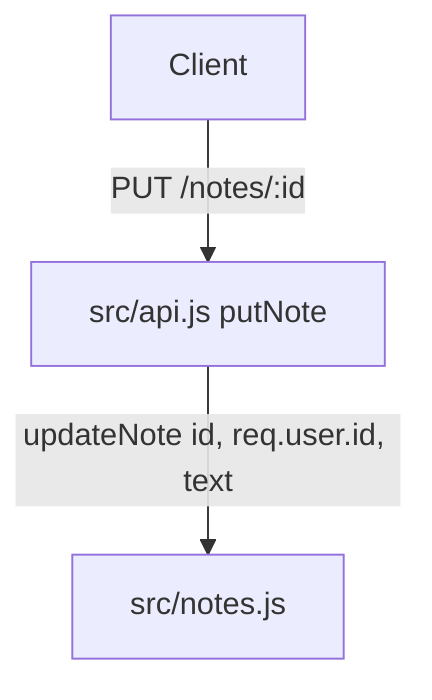

# Design: note-edits

## Overview
`updateNote()` in the notes store (`src/notes.js`) changes a note's text after three checks — the note exists, it belongs to the signed-in user, the text fits; the `putNote` handler (`src/api.js`) passes the signed-in user's id from the session and turns a refusal into its status code.

## Architecture


## Reuse & Integration
| Kind | What | Where (path) | Why / notes |
|---|---|---|---|
| Reuse | the in-memory note store and its ids | `src/notes.js` | `addNote()` / `getNote()` already own the notes; the edit changes a stored note in place |
| Extend | the request handlers | `src/api.js` | a `putNote` handler beside `postNote` / `getNotes`, the same `{ status, body }` answers |
| New | `updateNote()` and `NoteError` (an error with a status) | `src/notes.js` | no error type with a status exists in the app (searched `Error`, `status`, `throw` in src/) |

**Module boundaries:** `src/notes.js` knows nothing of requests; `src/api.js` is the only place that reads `req`.

## Alternatives & Trade-offs
| Decision | Option | Pros | Cons | Cost if wrong | Chosen |
|---|---|---|---|---|---|
| Who the editor is | The user id from the session (`req.user.id`) | The client can't choose it | The handler needs the session | none | ✓ |
| Who the editor is | A user id the client sends in the body | No session needed | Anyone can edit anyone's note | a privacy incident | ✗ |

## Data Models
```typescript
interface Note {
  id: number;
  orderId: string; // o-1001
  userId: number;  // who wrote it
  text: string;    // at most 500 characters
}
```

## API Contracts
### `putNote(req)` — PUT /notes/:id
- **Input:** `req.params.id`, `req.body.text`, `req.user` (the session's user).
- **Output:** `{ status: 200, body: note }` · 400 text too long · 403 not the author · 404 no such note — `{ error }` in the body.

## Security Considerations
The editor's identity comes from the session only (US-1.AC-3); the body carries the text and nothing else that is trusted.

## Error Handling
`updateNote()` throws a `NoteError` with the status; `putNote` answers it and rethrows anything else.

## Testing Strategy
- Unit: `test/notes.test.js` — T-01 an edit by the author (US-1.AC-1), T-02 a 501-character text (US-1.AC-2), T-03 another user (US-1.AC-3), T-04 an unknown id (EC-1).

## Risks
| Risk | Likelihood | Impact | Mitigation | Owner |
|---|---|---|---|---|
| A later handler trusts an id from the body again | low | high | US-1.AC-3's test sends a body naming another user | maintainer |

## Constitution Check
- [x] No runtime dependencies — complies, Node core only.
- [x] Every behaviour change ships with a test that names its T-ID — complies, T-01 to T-04.
- [x] Output formats are stable — complies, a new handler only.

## Complexity Tracking
None.
